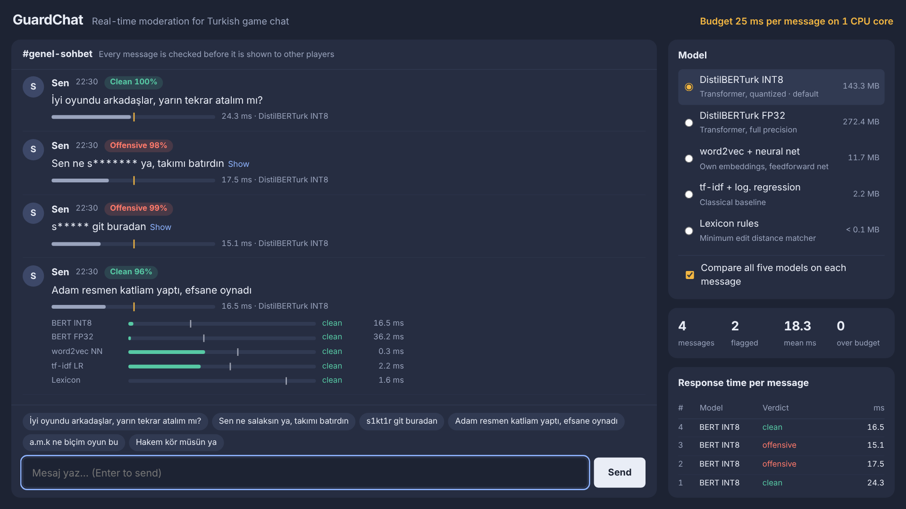

# GuardChat: real-time moderation for Turkish game chat

SWE015 Homework, **Use Case 4: Real-Time Chat Moderation**.
A chat interface in which every Turkish message is labelled **clean** or **offensive** with a confidence,
flagged messages are masked, and a side panel logs the response time of every message against a
**25 ms per-message budget on one CPU core**. You can switch live between the five models of the ladder,
or compare all of them on the same message. By default the app runs the **INT8-quantized DistilBERTurk**.



- Demo video (2 min): <!-- VIDEO_LINK -->
- Slides: [`docs/GuardChat_SWE015.pdf`](docs/GuardChat_SWE015.pdf)
- Architecture: [`docs/architecture.png`](docs/architecture.png)

## Quick start

Requires Python 3.10 or newer (tested with 3.13) and about 1.5 GB of free disk space (PyTorch + models).

```bash
git clone https://github.com/9i0s/swe015-chat-moderation.git
cd swe015-chat-moderation
python -m venv .venv
# Windows: .venv\Scripts\activate      macOS / Linux: source .venv/bin/activate
pip install -r requirements.txt
```

Single run command:

```bash
python run_app.py
```

Then open **http://127.0.0.1:8000**. On the first start, `run_app.py` downloads the trained weights
(about 400 MB, two zip files on Google Drive) into `models/`. Weights are not stored in this repository.
If the download is blocked on your network, download the two files from
<!-- WEIGHTS_LINKS --> by hand, put them in the repository folder and run `python scripts/download_models.py`
(it unpacks zip files that are already present).

> On Linux without a GPU you can install the much smaller CPU-only PyTorch first:
> `pip install torch --index-url https://download.pytorch.org/whl/cpu`, then `pip install -r requirements.txt`.

## What is inside

| Model (ladder step) | Area | What it is | Code |
|---|---|---|---|
| Edit-distance lexicon (rule baseline) | B | Minimum edit distance (Levenshtein) against a hand-curated list of Turkish insults; also used for masking | `moderation/lexicon.py` |
| 1. tf-idf + logistic regression (classical baseline) | B | Word 1–2-grams + character 2–5-grams, balanced logistic regression | `scripts/train_tfidf.py` |
| 2. word2vec + feedforward network | A | Own skip-gram word2vec on the training tweets, [mean; max] pooling, 200→128→64→2 MLP trained with SGD + backpropagation | `scripts/train_w2v_ffnn.py` |
| 3. DistilBERTurk, fine-tuned (FP32) | C | `dbmdz/distilbert-base-turkish-cased` + classification head, fine-tuned with AdamW | `scripts/train_transformer.py` |
| 4. DistilBERTurk, INT8 (deployed) | C + D | Post-training dynamic INT8 quantization of all Linear layers | `scripts/quantize.py` |

Pre-processing (area B) is in `moderation/normalize.py`: Turkish-aware lower-casing (I→ı, İ→i), leetspeak
(`s1kt1r` → `siktir`), letters split by dots, stars or spaces (`a.m.k` → `amk`), repeated letters and
@USER/URL handling. The Transformer gets a lighter version that keeps casing and punctuation and only
rewrites obfuscated words.

### Technique map

| Area | Technique | Where |
|---|---|---|
| A · Neural networks | word2vec embeddings trained on our data; feedforward network, SGD + backpropagation, dropout, early stopping | `scripts/train_w2v_ffnn.py`, `moderation/models.py` |
| B · Classical NLP | regex normalisation; minimum edit distance lexicon matcher; tf-idf + logistic regression | `moderation/normalize.py`, `moderation/lexicon.py`, `scripts/train_tfidf.py` |
| C · Transformers | DistilBERTurk (self-attention encoder, WordPiece tokenizer) fine-tuned with a classification head | `scripts/train_transformer.py` |
| D · Efficient models | dynamic INT8 quantization; latency budget 25 ms/message on 1 CPU core; size/latency/accuracy benchmark | `scripts/quantize.py`, `scripts/evaluate.py` |

## Results

Test set: 3176 tweets (613 offensive). Hardware: Intel(R) Xeon(R) Processor @ 2.10GHz, 1 thread, batch 1, 200 runs. Latency budget: 25 ms/message.

| Model | Area | Number format | Macro-F1 (95% CI) | Off. recall | Size (MB) | Latency mean / p95 (ms) | Budget |
|---|---|---|---|---|---|---|---|
| Edit-distance lexicon (rules) | B | - | 0.670 (0.648-0.693) | 0.308 | 0.005 | 2.5 / 6.8 | yes |
| tf-idf + logistic regression | B | FP64 | 0.763 (0.743-0.782) | 0.599 | 2.2 | 1.7 / 2.3 | yes |
| word2vec + feedforward NN | A | FP32 | 0.659 (0.637-0.680) | 0.437 | 11.7 | 0.1 / 0.2 | yes |
| DistilBERTurk fine-tuned (FP32) | C | FP32 | 0.792 (0.773-0.810) | 0.602 | 272.4 | 44.6 / 61.2 | no |
| DistilBERTurk fine-tuned (INT8) | C+D | INT8 (dynamic) | 0.785 (0.768-0.802) | 0.657 | 143.3 | 12.9 / 22.4 | yes |

FP32 vs INT8 Transformer: identical labels on 94.7% of test messages.

**Findings**

- **DistilBERTurk FP32** is the most accurate model (macro-F1 0.792, offensive precision 0.725) but needs 44.6 ms per message and misses the 25 ms budget.
- **INT8 quantization** makes it 3.5× faster (12.9 ms) and 1.9× smaller (143 MB; the FP32 embedding table is not quantized) for a loss of 0.007 macro-F1; 94.7 % of test labels are unchanged. This is the model the app runs.
- **Batch size matters for dynamic INT8:** activation scales are computed per batch, so scoring 64 padded messages together changed individual INT8 scores by up to 0.5. INT8 is therefore evaluated one message at a time, exactly like the app.
- **tf-idf + logistic regression** is a strong, cheap baseline (0.763 in 1.7 ms, 2.2 MB); the INT8 model beats it by 0.023, and the 95 % intervals overlap slightly.
- **word2vec + feedforward network** is the weakest learned model (0.659): averaging word vectors loses word order, and 25k tweets are too few to learn good embeddings.
- **The lexicon rules** are precise (0.716) but find only 31 % of offensive tweets; the app uses them to decide which words to mask.
- Inference-time de-obfuscation for the Transformer changes 9 of 3,176 validation tweets and leaves validation macro-F1 unchanged (FP32 0.787, INT8 0.784). It is kept because deliberate leetspeak (`s1kt1r`) is much more common in game chat than in tweets.

All numbers come from `scripts/evaluate.py` and are stored in [`results/results.json`](results/results.json).

## Reproduce everything

```bash
python scripts/prepare_data.py        # download OffensEval-TR 2020 and rebuild the exact split (data/split_ids.json)
python scripts/train_tfidf.py         # ~1 min
python scripts/train_w2v_ffnn.py      # ~1 min
python scripts/train_transformer.py   # ~70 min on 2 CPU cores (downloads dbmdz/distilbert-base-turkish-cased)
python scripts/quantize.py            # seconds
python scripts/evaluate.py            # same test set for every model -> results/results.json, models/thresholds.json
python run_app.py
```

## Data split and measurement

- **Data:** OffensEval-TR 2020 sub-task A (31,756 labelled tweets, 19.3 % offensive), downloaded from a public
  GitHub mirror pinned to one commit. The official test labels are not in the mirror, so we hold out our own
  stratified split: 80 % train, 10 % validation, 10 % test (seed 42). The split IDs are in `data/split_ids.json`;
  tweet texts are not redistributed in this repository.
- **Thresholds:** each model's decision threshold is tuned on the validation split for macro-F1, then frozen.
- **INT8 is scored one message at a time**, exactly like the app: dynamic quantization computes activation scales per
  batch, so in padded batches a message's score depends on its neighbours (FP32 does not; it is batched for speed).
  The test set is used once, for all five models.
- **Latency:** end-to-end (normalisation + features + model) for a single message, batch size 1, PyTorch on
  **one CPU thread**, mean and 95th percentile over 200 test messages after 10 warm-up runs.
- **Confidence shown in the app:** distance of P(offensive) from the model's tuned threshold, rescaled to 50–100 %.
  The raw probability is visible in the compare view.

## Repository layout

```
app/server.py            FastAPI back end (POST /api/moderate, GET /api/models)
app/static/index.html    chat UI, model switcher, latency log
moderation/              normaliser, lexicon matcher, model wrappers shared by app and evaluation
scripts/                 data preparation, training, quantization, evaluation, weight download
results/                 metrics, training logs
docs/                    architecture diagram, slides, screenshot
run_app.py               single run command
```

## Sources

- Çöltekin, Ç. (2020). *A Corpus of Turkish Offensive Language on Social Media.* LREC 2020. (OffensEval-TR data)
- Zampieri, M. et al. (2020). *SemEval-2020 Task 12: OffensEval 2020.*
- Data mirror: [jb-1811/NLP_with_NN_ws1920_OffensEval2020](https://github.com/jb-1811/NLP_with_NN_ws1920_OffensEval2020) @ `30b30f8`
- Schweter, S. (2020). *BERTurk / DistilBERTurk*, dbmdz, [`dbmdz/distilbert-base-turkish-cased`](https://huggingface.co/dbmdz/distilbert-base-turkish-cased) (MIT)
- Sanh et al. (2019) DistilBERT; Mikolov et al. (2013) word2vec; PyTorch dynamic quantization.

## AI usage

Claude (Anthropic) was used as an AI coding assistant: it wrote the code, ran the training and measurements,
drew the architecture diagram and drafted the slides and the video script. The video narration was generated
with the open Kokoro-82M text-to-speech model. Every reported number comes from the runs logged in `results/`.
